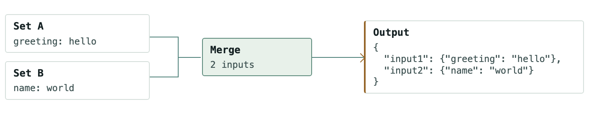

## Flow Architect

Turn a prompt into a workflow you can edit and run. [View repository](https://github.com/SkrimerForever/flow-architect)

**Workflow example · Merge two inputs**

<picture>
  <source media="(prefers-color-scheme: dark)" srcset="assets/flow-architect-dark.png">
  
</picture>

[Pipeline test](https://github.com/SkrimerForever/flow-architect/blob/main/tests/pipeline_test.go#L170)

[YandexGPT Gap Analysis](https://github.com/SkrimerForever/yandexgpt-gap-analysis) · [MOEX Trading Bot](https://github.com/SkrimerForever/moex-trading-bot)
